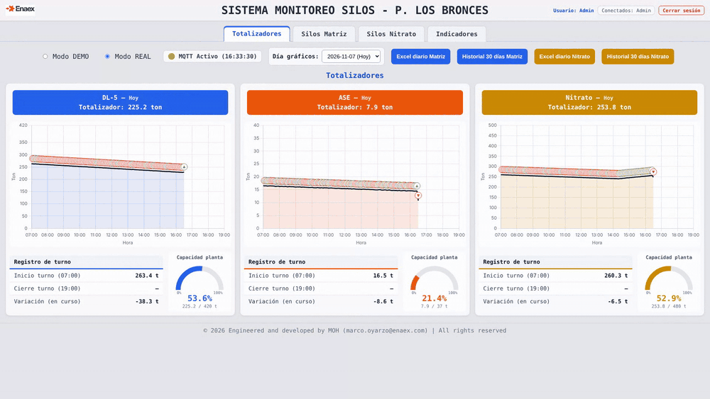
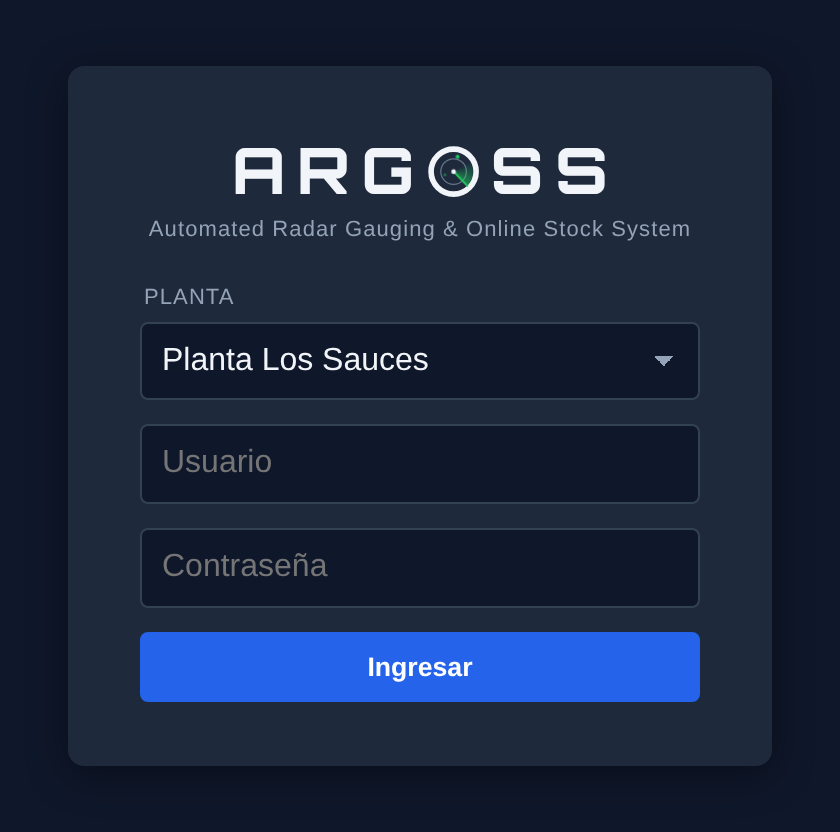

# ARGOSS — Automated Radar Gauging & Online Stock System

**Bulk silo monitoring for Matriz and ammonium nitrate · Los Sauces plant**

ARGOSS is a real-time monitoring system for bulk product storage silos at the Los Sauces plant. A radar level sensor installed in each silo measures the distance to the product surface and communicates over Modbus with a Delta HMI, which publishes the readings to an MQTT broker. The web dashboard turns those readings into level, volume, mass and fill percentage per silo, plant totals per product, shift records, alarms, 30-day history and consumption indicators.

The name ARGOSS comes from Argos Panoptes, the hundred-eyed giant of Greek mythology who never stopped watching — like the radars that keep every silo under constant observation.

ARGOSS is published on **argoss.cl**, a single domain prepared for several plants: the login page has a plant selector and each plant runs its own independent server on its own subdomain (`lossauces.argoss.cl`).

One server and one web page monitor two silo systems:

- **Matriz silos** — 8 silos · products DL-5 / VE-03 / ASE
- **Ammonium nitrate silos** — 8 silos



*Walkthrough with simulated plant data: live MQTT readings (consumption and a silo being refilled up to the high-level alarm) and 30 days of generated history.*

---

## Features

- Real-time level, volume, mass (t) and fill % for 16 silos, updated on every MQTT message
- High-level alarms (≥ 85 % warning, ≥ 90 % critical)
- Daily trend chart (07:00–19:00) of the plant total per product, with ▲/▼ change markers and zoom
- Per-silo mini chart of fill %
- Shift record (07:00 start / 19:00 close) and an automatic daily summary saved at 19:00
- 30-day history, browsable by date
- Plant capacity gauge per product
- **Indicators** page: daily consumption, receptions and per-silo usage over 30 days, with a radar-noise filter
- **Events** page: a 3-month event log — user sessions and actions, communications (MQTT broker, silos or HMI without data), process events (refills, jumps, false readings, radar noise) and operation (shift records, daily summary), with filters, live updates and Excel/CSV export
- Login with bcrypt-hashed users, 8 h sessions, live list of connected users
- Multi-plant login: one domain (`argoss.cl`) with a plant selector; each plant keeps its own server, users and history
- Role-based access: downloads and DEMO mode are visible only to the `Admin` user
- Daily Excel report and 30-day CSV export per system (Admin only)
- REAL / DEMO modes (DEMO generates random data in the browser)
- Product assignment per Matriz silo

---

## Pages

### Login



Behind the login box, an animated **radar background** (drawn in a canvas, no video or external files): range rings, a sweep that turns every 6 s with a fading trail, echo pulses and targets that light up as the sweep passes. It pauses when the tab is hidden and stays still when the device asks for reduced motion.

The login asks for the **plant**, user and password. On `argoss.cl` the form is sent to the selected plant's server; on a plant server (or by IP) the local plant is preselected and the login stays local. A failed login or logout returns to the same screen with the plant preselected, and the browser remembers the last plant used. See [Publishing on argoss.cl](#publishing-on-argosscl-multi-plant).

### Dashboard

The page has five tabs. ARGOSS opens on **Totalizadores**, and the active tab is kept in the URL (`/#totales`, `/#matriz`, `/#nitrato`, `/#kpi`, `/#eventos`). The user interface is in Spanish.

| Tab | Content |
|---|---|
| **Totalizadores** (plant totals) | Daily trend charts 07:00–19:00 for DL-5, ASE (and VE-03 when a silo holds it) and Nitrate. Under each chart: shift-record table (07:00 start, 19:00 close, variation) and a plant-capacity gauge |
| **Silos Matriz** | 8 silo cards: level, volume, mass, %, gauge, fill-% mini chart, product selector (DEMO mode) |
| **Silos Nitrato** | 8 silo cards with the same data; `≈` marks levels in the hopper zone, where the value is approximate |
| **Indicadores** (indicators) | Last 30 days from history: per product, today's consumption, daily average, 30-day consumption and receptions with number of refills; daily consumption vs. reception chart; per-silo daily consumption table with totals, refills, discarded jumps (power cuts) and measured radar noise |
| **Eventos** (events) | Event log of the last 3 months: status cards (communications now, silos without data now, today's alarms, today's refills and, for Admin, today's logins), category filters with counts, date / severity / silo / user filters, search, table grouped by day with live updates. See [Event log](#event-log-libeventosjs) |

The header shows the Enaex logo with the **plant name** below it (taken from `plantas.json` using `PLANTA_ID`, so each plant server shows its own), the **ARGOSS** logotype in the **Orbitron** typeface with a **radar "O"** — an SVG ring with a sweep that slowly rotates (one turn every 4 s; it stays still when the device asks for reduced motion) and two echoes — also used on the login page, with the **version number** next to it (hover to see the Git commit) and its meaning, *Automated Radar Gauging & Online Stock System*. Next to the version, a **signal indicator** shows **ONLINE** (green) when Matriz or Nitrate received MQTT data in the last 5 minutes and **OFFLINE** (red) otherwise; both systems share the HMI and broker, and the time of the last reading appears when hovering over it. On the right, the current user and the **Cerrar sesión** (logout) button, with the list of connected users right below them (centered on phones). The browser tab title is "ARGOSS · <plant>".

**Dark theme.** The whole dashboard uses the same dark navy palette as the login. Every interface color is a CSS variable in one block at the top of [`public/styles.css`](public/styles.css) (`--bg`, `--surface`, `--text`, `--chart-grid`…); the charts read them through `scadaColor()` (`public/main.js`), so a tone is changed in one place. Product colors (DL-5 blue, VE-03 green, ASE orange, Nitrate yellow) and status colors (green / amber / red) are unchanged.

The top bar is shared by all tabs: REAL/DEMO selector (Admin only; other users always see REAL), the **Fecha** (date) selector for the charts and the download buttons (Admin only, shown according to the active tab).

**Plant capacity** (gauge in Totalizadores): DL-5 420 t, ASE 37 t, Nitrate 480 t. Change it in `PRODUCT_CAPACITY` in `public/matriz.js` and `public/nitrato.js` (VE-03 has no capacity defined).

---

## Level and mass calculation

### Matriz

`level = 5.92 − radar_distance × 0.98`. Volume is a cone + cylinder (46.168 m³). Densities: DL-5 1300 kg/m³, VE-03 1370 kg/m³, ASE 800 kg/m³.

### Ammonium nitrate

The geometry and formulas match the plant's conventional spreadsheet (*Cálculo de MMPP en Silos*):

| Section | Geometry | Volume |
|---|---|---|
| Column | 3.48 × 3.48 m, height 5.95 m | 72.06 m³ |
| Intermediate hopper | truncated pyramid 3.48 → 2.78 m, height 0.78 m | 7.67 m³ |
| Final hoppers | 2 × truncated pyramid 1.39 × 2.78 → 0.32 × 0.38 m, height 1.16 m | 3.61 m³ |
| **Total** | height 7.89 m (level measured from the bottom of the final hoppers) | **83.34 m³** |

Density is 750 kg/m³, the same as the spreadsheet (`NITRATO_DENSIDAD`). Fill % is volumetric.

**Radar calibration.** At startup, a straight line `distance = A·radar + B` is fitted by least squares to the field points in `RADAR_CALIBRATION` (`lib/nitrato-model.js`): LiDAR measurements from June 2026 and manual tape measurements from November 2026. All points are referenced like the spreadsheet (measurement − 0.09 m hatch height). Current fit: `1.039·radar − 0.072`, error < 9 cm. To recalibrate, add rows and restart; the startup log prints the resulting line.

| Real distance | Level |
|---|---|
| ≤ 5.95 m | Column: level = 7.89 − distance |
| 5.95 – 6.73 m | Intermediate hopper: level = 7.89 − distance (shown with `≈`) |
| 6.73 m – empty reading | Final hoppers, approximated down to the empty-silo level (`≈`) |
| radar ≥ 7.05 m | Empty silo: residual mass `NITRATO_MASA_VACIO_TON` (0.10 t) |

The radar cannot see the bottom of the two final hoppers (an empty silo reads about 7.05 m), so that zone is approximate.

The nitrate model lives in `lib/nitrato-model.js` and is shared by the server and the history recalculation tool, so both always compute the same way.

### Recalculating history after a model change

History stores computed values (tonnes and %). When the calculation model changes, older points keep the old model and the chart shows a step. `tools/recalcular-historial-nitrato.js` rebuilds the original radar reading from each stored % and recomputes every point with the current model (per silo, plant total and shift record), with an automatic backup in `backups/`:

```sh
pm2 stop scada-silos
node tools/recalcular-historial-nitrato.js              # dry run: shows the changes
node tools/recalcular-historial-nitrato.js --aplicar    # apply (--dias N or --todo for earlier days)
pm2 start scada-silos
```

The switch-over time is read from the PM2 log. If it is not found, pass it with `--corte "YYYY-MM-DD HH:MM"`. Converted days are recorded in `nitrato_recalculo.json` and are never converted twice.

---

## Indicators (`lib/kpi.js`)

Indicators are computed per silo from the fill % stored every 5 minutes, converted to tonnes with each system's model. Decreases count as consumption and increases as reception.

- **Radar-noise filter:** 35-minute moving median, then hysteresis with an adaptive threshold per silo and per day (3σ of the measured noise, minimum `KPI_UMBRAL_TON` = 0.3 t). In 30-day simulations the consumption and reception error stays below 3 % with radar noise up to ±6 cm plus spurious spikes.
- **Refill:** a *gradual* rise of more than `KPI_RECARGA_MIN_TON` (2 t) — the level increases over at least `KPI_RECARGA_MIN_PASOS` (3) consecutive filter steps, i.e. ≥ 15 min rising. Any other rise (sudden, or under 2 t) is neither a refill nor a reception. If the level falls back afterwards (oscillation) or the rise was under 2 t (radar drift), the reference returns to the previous level so the later fall is not counted as consumption either. A sudden rise ≥ 2 t that persists (e.g. a refill made entirely during an outage) becomes the new reference level.
- **Jumps (power cuts, sensor/HMI restarts):** if the fill % changes more than `KPI_SALTO_PCT` (10 points) per 5 minutes elapsed between two valid readings, the series is cut there and the jump is not counted as consumption or reception. If the level later returns close to its previous value, the false readings in between are discarded and both sides are joined, so real consumption during the outage is still counted. A real refill already in progress continues to count across a power cut. A refill that happens entirely while the system has no data is not counted as a refill or reception; the new level simply becomes the reference.
- Readings of exactly 0 % or ≥ 99.5 % (a radar restarting reports distance 0; the product never reaches the antenna) are treated as "no data".
- The **Saltos** column shows how many jumps were discarded per silo in 30 days.
- Matriz silos use their current product assignment.
- The **Radar noise** column (1σ, in tonnes) helps detect a sensor that needs attention.
- The tab loads when opened and refreshes automatically every 5 minutes while it is visible. The filter runs on the server and is not shown on the page; its parameters are set in `.env` (see [Configuration](#configuration-env)).

---

## Event log (`lib/eventos.js`)

The **Eventos** tab records, with date and time, everything relevant that happens in the system. Each event has a severity — **Info**, **Aviso** (warning) or **Alarma** (alarm) — and a category:

| Category | Events | Visible to |
|---|---|---|
| **Comunicaciones** | Server started / stopped (with the version and Git commit; an unrecorded previous stop is flagged as a VM power cut or crash) · MQTT broker connected / disconnected / reconnected · **Silo sin datos**: a silo that publishes nothing for `EVENTOS_SIN_DATOS_MIN` minutes, and when it recovers · **HMI sin datos** (alarm): no silo publishes, likely a power or network cut at the plant, and when it recovers with the outage duration | Everyone |
| **Proceso** | **Recarga iniciada** (a gradual refill is confirmed) and **Recarga** (when it ends, with tonnes, duration and start → end mass) · **Salto** (a jump that persists) · **Lectura falsa descartada** (the level jumped and came back) · **Saltos frecuentes** (more than 3 jumps in a day for one silo; the rest are not listed one by one) · **Lectura fuera de rango** (0 %, ≥ 99.5 % or an impossible radar distance) · **Ruido del radar elevado** (today's noise is at least 3 times the usual of the previous 7 days) | Everyone |
| **Usuarios** | Login, failed login (user typed and IP; never the password), logout with session length · connected / disconnected (page opened with an active session, or closed for more than 1 min) · downloads · Matriz product change · REAL / DEMO mode change | Admin |
| **Operación** | Shift records 07:00 / 19:00 with the stock per product · daily summary saved · nitrate history recalculation (`tools/`) · disk almost full | Admin |

Refills, jumps and false readings use exactly the same rules as the Indicators tab (`lib/kpi.js`), checked every 5 minutes, and keep the time at which they happened. A jump is recorded 60 minutes later, once it is known whether the level came back (false reading). High and low level alarms are not recorded.

**Access:** Admin sees all categories, the user column (with IP in the export) and the **Excel** / **CSV** download of the filtered events. Other users only see *Comunicaciones* and *Proceso*. The server enforces it: `/eventos` never returns user or operation events to them, and `/eventos/export` answers 403.

**Storage:** one file per month in `eventos/` (`eventos_YYYY-MM.jsonl`, one JSON line per event, append-only so a power cut cannot corrupt earlier events). Events older than `EVENTOS_RETENCION_DIAS` (90 days) are deleted automatically. The folder is not tracked by Git, so `git pull` never touches it.

---

## MQTT

Delta HMI payload with word swap: `{ "d": { "tipo": 12345678 } }` (uint32 → float = radar distance in metres).

| System | Topics | Silo |
|---|---|---|
| Matriz | `planta/losbronces/silos/tanque1` … `tanque8` | Silo 1 … Silo 8 |
| Nitrate | `planta/losbronces/silos/tanque11` … `tanque18` | Nitrate silo 1 … silo 8 |

Both systems use the same HMI and topic prefix. Nitrate identifies the silo from the last topic segment and also accepts `silo11` … `silo18` as aliases. Both connect to `mqtt://localhost:1883` by default (see the configuration table below).

---

## Installation

Requirements: [Node.js](https://nodejs.org/) ≥ 18, [npm](https://www.npmjs.com/), [Git](https://git-scm.com/downloads), [Eclipse Mosquitto](https://mosquitto.org/), [PM2](https://pm2.keymetrics.io/).

```sh
git clone https://github.com/moyarzo/scada-silos-bronces.git
cd scada-silos-bronces
npm install
```

Create the `.env` file with the users (see `env.example` for every option). Each password is stored only as a bcrypt hash:

```sh
echo "SESSION_SECRET=$(node -e "console.log(require('crypto').randomBytes(32).toString('hex'))")" > .env
echo "USER1_NAME=Admin" >> .env
echo "USER1_HASH=$(node generate-hash.js 'AdminPassword')" >> .env
echo "USER2_NAME=operator1" >> .env
echo "USER2_HASH=$(node generate-hash.js 'OperatorPassword')" >> .env
```

Set the server to the plant's time zone. Shifts, the 19:00 summary and chart labels use the server clock:

```sh
sudo timedatectl set-timezone America/Santiago
```

### Running

```sh
# Development
node server.js

# Production
pm2 start ecosystem.config.js
pm2 save
pm2 startup
```

> [!IMPORTANT]
> Open http://localhost:3000/

On startup the log lists the loaded users and the nitrate calibration. If the `.env` file is missing or a hash is malformed, a warning is printed.

### Publishing on argoss.cl (multi-plant)

One domain serves every plant. Each plant runs its own independent ARGOSS server (own users, history and MQTT broker) on its own subdomain, and `argoss.cl` is the shared entry point: the same login page with an extra **Plant** selector.

```
argoss.cl              →  login with plant selector (static portal)
lossauces.argoss.cl    →  ARGOSS Planta Los Sauces (this server)
<plant>.argoss.cl      →  future plants (their own server)
```

The user picks the plant, enters their credentials, and the form is sent to that plant's server (`https://<plant>.argoss.cl/login`). A failed login or **Cerrar sesión** returns to `argoss.cl` with the plant preselected. The browser also remembers the last plant used. The plant list lives in [`plantas.json`](plantas.json); the plant served by this machine is set with `PLANTA_ID` and its login is always sent locally, so access by IP keeps working without a domain.

1. Register `argoss.cl` and create DNS **A records** pointing to the VM's static IP: `@`, `www` and `lossauces`.
2. Open ports **80** and **443** in the cloud firewall.
3. Install Nginx and Certbot: `sudo apt install nginx certbot python3-certbot-nginx`
4. Publish the portal (copies `public/login.html`, `plantas.json` and the `public/fonts/` typeface to `/var/www/argoss`). Run it again whenever the login or the plant list changes:

   ```sh
   bash deploy/publicar-portal.sh
   ```

5. Install the Nginx site from [`deploy/nginx-argoss.conf`](deploy/nginx-argoss.conf) (portal + `lossauces.argoss.cl` with the WebSocket headers Socket.IO needs) and get the certificates. Certbot adds HTTPS, the HTTP → HTTPS redirect and automatic renewal:

   ```sh
   sudo cp deploy/nginx-argoss.conf /etc/nginx/sites-available/argoss
   sudo ln -s /etc/nginx/sites-available/argoss /etc/nginx/sites-enabled/
   sudo nginx -t && sudo systemctl reload nginx
   sudo certbot --nginx -d argoss.cl -d www.argoss.cl -d lossauces.argoss.cl
   ```

6. Add to `.env`, then run `pm2 restart scada-silos` and close port 3000 in the firewall:

   ```sh
   HOST=127.0.0.1
   HTTPS_PROXY_MODE=true
   PLANTA_ID=lossauces
   PORTAL_URL=https://argoss.cl
   ```

**Adding a plant:** deploy ARGOSS on the new plant's server with its own `PLANTA_ID`, add a DNS A record for `<plant>.argoss.cl`, set up Nginx + Certbot there, add the plant to `plantas.json` in the repository (`id`, `nombre`, `url`), and run `bash deploy/publicar-portal.sh` again on the portal VM.

### Updating without losing history

Data files are not touched by updates, so `git pull` followed by `pm2 restart scada-silos` keeps all history. Do not run `git reset --hard` or `git checkout .` on the server: they can revert `historyData.json` and `turnData.json`.

---

## Configuration (`.env`)

| Variable | Default | Description |
|---|---|---|
| `SESSION_SECRET` | — | Session signing secret (required) |
| `USER1_NAME` … `USER5_NAME` / `USER1_HASH` … `USER5_HASH` | — | Users and bcrypt hashes (`node generate-hash.js 'password'`) |
| `ADMIN_USERS` | `Admin` | Comma-separated administrator users (case-insensitive) |
| `PORT` | `3000` | HTTP port |
| `HOST` | `0.0.0.0` | Bind address; use `127.0.0.1` behind Nginx so port 3000 is not exposed |
| `HTTPS_PROXY_MODE` | `false` | `true` behind an HTTPS reverse proxy: trusts `X-Forwarded-*` and sends the session cookie only over HTTPS |
| `PLANTA_ID` | `lossauces` | Plant served by this server (an `id` from `plantas.json`): its name is shown under the logo and in the browser tab, and its login is sent locally |
| `PORTAL_URL` | — | Plant-selection portal (e.g. `https://argoss.cl`). A failed portal login and logout return here |
| `MQTT_URL` | `mqtt://localhost:1883` | Broker for both systems |
| `MQTT_URL_MATRIZ` / `MQTT_URL_NITRATO` | `MQTT_URL` | Per-system broker override |
| `MQTT_TOPIC_MATRIZ` | `planta/losbronces/silos/#` | Matriz subscription |
| `MQTT_TOPIC_NITRATO` | `planta/losbronces/silos/#` | Nitrate subscriptions (comma-separated) |
| `NITRATO_DENSIDAD` | `750` | Nitrate density (kg/m³) |
| `NITRATO_MASA_VACIO_TON` | `0.10` | Residual mass shown for an empty nitrate silo (t) |
| `KPI_UMBRAL_TON` | `0.3` | Minimum noise threshold for indicators (t) |
| `KPI_RECARGA_MIN_TON` | `2` | Minimum mass to count a refill (t) |
| `KPI_RECARGA_MIN_PASOS` | `3` | Minimum consecutive rising steps for a gradual refill |
| `KPI_SALTO_PCT` | `10` | Maximum credible change in fill % per 5 min; larger changes are jumps |
| `EVENTOS_RETENCION_DIAS` | `90` | Days the event log is kept (3 months) |
| `EVENTOS_SIN_DATOS_MIN` | `10` | Minutes without readings before a silo (or the whole HMI) is reported without data |
| `EVENTOS_DISCO_PCT` | `85` | Disk usage (%) that triggers a "disk almost full" event |

---

## Users and roles

| Feature | Admin | Other users |
|---|---|---|
| Totalizadores, Silos Matriz, Silos Nitrato | ✔ | ✔ |
| Indicadores tab | ✔ | ✔ |
| Eventos tab: communications and process events | ✔ | ✔ |
| Eventos tab: user and operation events, user filter, Excel / CSV | ✔ | — |
| REAL / DEMO selector | ✔ | — (always REAL) |
| Excel / CSV downloads | ✔ | — |

Restrictions are enforced on the server too: download routes return HTTP 403 for non-admin users, and the event log never sends user or operation events to them.

---

## Project structure

```
scada-silos-bronces/
├── server.js                 ← Express, login/session, Socket.IO (connected users)
├── lib/
│   ├── utils.js              ← Shared helpers (dates, JSON, Delta decoding)
│   ├── matriz.js             ← Matriz backend   (Socket.IO /matriz,  routes /matriz/*)
│   ├── nitrato.js            ← Nitrate backend  (Socket.IO /nitrato, routes /nitrato/*)
│   ├── nitrato-model.js      ← Nitrate geometry, radar calibration, level and volume
│   ├── kpi.js                ← Consumption / reception / per-silo indicators
│   └── eventos.js            ← Event log: recording, monitoring, query and export
├── tools/
│   └── recalcular-historial-nitrato.js   ← Recalculate nitrate history after a model change
├── deploy/
│   ├── nginx-argoss.conf     ← Nginx: argoss.cl portal + lossauces.argoss.cl
│   └── publicar-portal.sh    ← Publish the login + plant list as the argoss.cl portal
├── public/
│   ├── index.html            ← Dashboard with the five tabs
│   ├── login.html            ← Login with plant selector (also served as the argoss.cl portal)
│   ├── main.js               ← Tabs, session, roles, shared MQTT status, shift table and capacity gauge
│   ├── matriz.js             ← Matriz frontend
│   ├── nitrato.js            ← Nitrate frontend
│   ├── kpi.js                ← Indicators tab
│   ├── eventos.js            ← Events tab
│   ├── fonts/                ← Orbitron (ARGOSS logotype), bundled so no external font service is needed (SIL Open Font License)
│   ├── styles.css
│   └── logo.png
├── docs/demo.gif             ← README walkthrough
├── docs/login.png            ← Login screenshot
├── template.xlsx             ← Daily Excel template (both systems)
├── siloConfig.json           ← Product per Matriz silo
├── plantas.json              ← Plants shown in the login selector
├── generate-hash.js          ← bcrypt hash generator for user passwords
├── ecosystem.config.js       ← PM2
├── env.example
└── package.json
```

### Data files (created at runtime)

| Matriz | Nitrate | Content |
|---|---|---|
| `turnData.json` | `nitrato_turnData.json` | Shift record 07:00 / 19:00 per day |
| `historyData.json` | `nitrato_historyData.json` | Plant total every 5 min (30 days) |
| `siloHistoryData.json` | `nitrato_siloHistoryData.json` | Fill % per silo every 5 min |
| `dailySummary.json` | `nitrato_dailySummary.json` | Daily summary saved at 19:00 |
| `exports/stock_diario_YYYYMMDD.xlsx` | `exports/stock_nitrato_YYYYMMDD.xlsx` | Daily Excel report |
| `historial_YYYYMMDD.csv` | `resumen_nitrato_YYYYMMDD.csv` | 30-day CSV export |

Shared by both systems: `eventos/eventos_YYYY-MM.jsonl` (event log, 3 months).

### HTTP routes

| Matriz | Nitrate | Access |
|---|---|---|
| `/matriz/export-data` | `/nitrato/export-data` | Admin |
| `/matriz/export-daily-summary` | `/nitrato/export-daily-summary` | Admin |
| `/matriz/export-trend` | `/nitrato/export-trend` | Admin |
| `/matriz/kpi` | `/nitrato/kpi` | Any logged-in user |

The legacy routes `/export-data`, `/export-daily-summary` and `/export-trend` still work for Matriz.

| Event log | Access |
|---|---|
| `/eventos?desde=&hasta=&cat=&sev=&silo=&usuario=&q=&limit=&offset=` | Any logged-in user (non-admin users only get communications and process events) |
| `/eventos/export?formato=xlsx` or `formato=csv` (same filters) | Admin |

---

## Versioning

The version shown next to ARGOSS is the `version` field of [`package.json`](package.json); the server reads it at startup (`pm2 restart` after changing it). The Git commit appears when hovering over it, in the startup log and in the **Servidor iniciado** event.

| Version | Milestone |
|---|---|
| 1.x | Separate Matriz and Nitrate SCADAs |
| 2.0 | Matriz + Nitrate in one system |
| **3.0** | ARGOSS: Indicators, Events, multi-plant login, argoss.cl |

Convention: `3.0.1`, `3.0.2`… for fixes (a calculation or text adjustment); `3.1`, `3.2`… for new features (a new tab or indicator); a new major version for changes in how the system is deployed or stores data.

---

## Testing

An Admin user can switch to **DEMO** mode, which generates random silo data in the browser to exercise the interface without MQTT. In **REAL** mode the dashboard shows the data received from the MQTT broker.

---

## License

MIT © 2026 Marco Oyarzo — see [LICENSE](LICENSE).
